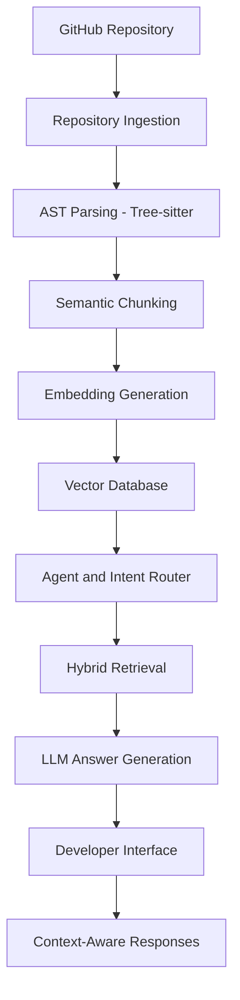

# Agentic Codebase Intelligence
### Your AI Engineering Assistant for Understanding and Working with Large-Scale Codebases

> **Understand any codebase. Navigate every dependency. Build with confidence.**

Agentic Codebase Intelligence is an AI-powered developer assistance platform designed to help software engineers understand, explore, debug, and work with complex software repositories — from small projects to extremely large, production-scale codebases.

Inspired by the capabilities of AI coding assistants such as **OpenAI Codex and Claude**, our vision is to build a developer-centric intelligence system that goes beyond conventional code completion and chatbot interactions.

Rather than simply generating code snippets, the system aims to understand the structure, relationships, execution flows, and dependencies of an entire codebase, enabling developers to interact with their projects through natural language.

Our goal is to make complex codebases easier to understand and work with, regardless of a developer's experience level.

---

## The Problem

Modern software systems consist of thousands of files, interconnected modules, complex dependencies, and layers of business logic.

Understanding an unfamiliar or large codebase can be challenging, even for experienced developers.

Some common challenges include:

- **Complex Code Navigation:** Finding the right implementation across thousands of files.
- **Lack of Context:** Traditional search tools return matching snippets without explaining their relationships or purpose.
- **Dependency Understanding:** Manually tracing function calls, module interactions, and cross-file dependencies.
- **Developer Onboarding:** Junior developers spend significant time understanding unfamiliar projects.
- **Production Complexity:** Investigating bugs and understanding the impact of changes across interconnected components.
- **Scalability:** Basic RAG systems often struggle to retrieve relevant context from very large repositories.

We aim to address these challenges through an agentic, repository-aware intelligence architecture.

---

## Our Vision

Build an intelligent engineering assistant that understands software repositories as interconnected systems rather than collections of independent files.

The platform is designed around three principles:

1. **Deep Codebase Understanding:** Build structural and semantic awareness of repositories, including relationships between files, functions, classes, and modules.
2. **Agentic Exploration:** Allow AI agents to dynamically navigate directories, retrieve relevant code, follow dependencies, and gather context before answering.
3. **Developer-Centric Intelligence:** Adapt assistance to different engineering needs, from understanding basic functions to investigating complex production architectures.

The long-term ambition is to support continuously growing and extremely large codebases through scalable indexing, intelligent retrieval, and context-aware agent workflows.

---

## Who Is It For?

We envision a platform that supports developers throughout their engineering journey.

| Developer Level | How It Helps |
|---|---|
| Junior Developers | Understand unfamiliar code, learn project structure, and follow execution flows. |
| Mid-Level Developers | Trace dependencies, debug issues, understand modules, and implement features. |
| Senior Developers | Investigate architecture, analyze cross-module interactions, and assess the impact of changes. |
| Tech Leads & Architects | Explore large systems, understand component relationships, and support technical decisions. |

---

## Core Capabilities

The following represents our planned product capabilities. Individual capabilities will be implemented and validated progressively.

### 1. Repository-Level Intelligence
- Ingest GitHub repositories.
- Understand directory and file structures.
- Analyze functions, classes, and modules.
- Retrieve relevant information across multiple files.
- Answer natural-language questions about the repository.

### 2. Agentic Codebase Exploration
- Intelligent intent recognition and query routing.
- Dynamic directory and file navigation.
- Tool-calling agents for targeted code exploration.
- Context gathering across interconnected modules.
- Multi-step reasoning before generating responses.

### 3. Structural Code Understanding
- Abstract Syntax Tree (AST) parsing.
- Syntax-aware semantic chunking.
- Function-level and class-level code extraction.
- Structural relationships between code components.
- Dependency-aware context retrieval.

### 4. Intelligent Retrieval and Generation
- Semantic vector search.
- Hybrid retrieval strategies.
- Context-aware information retrieval.
- Retrieval-Augmented Generation (RAG).
- Grounded natural-language responses.

### 5. Developer Assistance — Long-Term Direction
- Code explanations and walkthroughs.
- Debugging assistance.
- Feature implementation guidance.
- Cross-file impact analysis.
- Architecture exploration and visualization.
- Automated refactoring suggestions.
- Pull request review assistance.

---

## Proposed Technical Architecture

Our initial technical direction combines AST-based code analysis, semantic retrieval, and agentic reasoning.

### System Workflow

### Architecture Components

| Component | Proposed Technology | Responsibility |
|---|---|---|
| Repository Ingestion | GitPython | Clone and process repositories |
| AST Parsing | Tree-sitter | Understand code structure |
| Semantic Chunking | Custom processing | Preserve meaningful code units |
| Embeddings | Hugging Face / Embedding Models | Convert code into vector representations |
| Vector Database | ChromaDB / FAISS | Store and retrieve code embeddings |
| Agent Framework | LangGraph / LlamaIndex | Agent orchestration and tool calling |
| Backend | FastAPI | API and processing layer |
| Frontend | React.js / Streamlit | Developer interaction |

*Note: These are candidate technologies from our initial architecture proposal. Final technology choices and implementation details may evolve during development.*

---

## Development Roadmap

We are approaching this as an evolving engineering product rather than a fixed-feature chatbot.

Our development will progress through the following proposed phases:

### Phase 1 — Repository Understanding Foundation
- GitHub repository ingestion.
- File and directory indexing.
- AST-based parsing.
- Semantic code chunking.
- Embedding generation.
- Vector database integration.

### Phase 2 — Intelligent Retrieval
- Semantic code search.
- Hybrid retrieval.
- Cross-file context gathering.
- Retrieval quality evaluation.
- Repository-level question answering.

### Phase 3 — Agentic Intelligence
- Intent classification and routing.
- Tool-calling agent architecture.
- Dynamic repository navigation.
- Dependency-aware exploration.
- Multi-step reasoning and response synthesis.

### Phase 4 — Developer Experience
- FastAPI backend integration.
- Interactive developer interface.
- Repository selection and management.
- Conversational codebase exploration.
- Context-aware responses with source references.

### Phase 5 — Testing and Evaluation
- Repository-level accuracy evaluation.
- Retrieval relevance testing.
- Large-codebase performance testing.
- Response quality and latency evaluation.
- End-to-end integration testing.

### Phase 6 — Advanced Engineering Capabilities
Long-term areas of exploration include:

- Multi-repository intelligence for microservices.
- Automated pull request review.
- Architecture diagram generation using Mermaid.js.
- IDE integration through a VS Code extension.
- Automated refactoring suggestions.
- Production-oriented scalability and optimization.

*These phases are provisional planning directions, not a finalized delivery commitment. Their scope and sequence will be refined as requirements and technical feasibility are validated.*

---

## What Makes This Different?

Our focus is not simply building another AI chatbot that can generate code.

We want to develop an intelligence layer that understands the software engineering environment in which developers work.

| Traditional Code Search | Our Proposed Approach |
|---|---|
| Keyword-based matching | Semantic and structural retrieval |
| Isolated code snippets | Repository-level context |
| Manual dependency tracing | Agent-assisted exploration |
| Limited architectural awareness | Structure-aware code understanding |
| Single-step responses | Multi-step agentic reasoning |
| Generic assistance | Developer-focused assistance across experience levels |

---

## Research Foundation

Our initial research and architecture are informed by work in:

- **cAST (2025):** AST-driven structural chunking for code retrieval.
- **SWE-agent (2024):** Agent-computer interfaces for software engineering.
- **RepoCoder (2023):** Iterative repository-level retrieval and generation.
- **GraphCodeBERT (2020):** Code representations incorporating data-flow information.
- **CodeRAG-Bench (2024):** Evaluation of retrieval-augmented code generation.

These works inform our initial approach to structural code understanding, repository navigation, and retrieval quality.

---

## Current Project Status

**Development Stage:** Architecture planning and implementation.

Our Phase-1 proposal establishes the problem definition, research foundation, technical pipeline, and initial development roadmap.

We are working toward a system that can move beyond basic repository Q&A and become a comprehensive AI engineering assistant.

The architecture, implementation priorities, and product capabilities will evolve as we validate the system against real-world repositories and developer workflows.

---

## Future Vision

We envision Agentic Codebase Intelligence as a platform where developers can bring an unfamiliar repository, ask complex engineering questions, understand its architecture, investigate issues, and progressively perform development tasks with AI assistance.

From a junior developer trying to understand their first large project to a senior engineer maintaining a complex production system, our objective is to make software engineering knowledge more accessible, contextual, and actionable.

**Not just an AI that writes code — an AI that understands the codebase developers work with.**

---

## Project Information

**Project:** Agentic Codebase Intelligence  
**Category:** Agentic AI | Software Engineering | Retrieval-Augmented Generation  
**Institution:** VNR Vignana Jyothi Institute of Engineering and Technology  
**Department:** Information Technology  
**Academic Year:** 2026–2027

### Contributors

- S. Saideep
- H. Sujith Kumar
- G. Ritesh
- V. Srikar

---

*Building toward a smarter way to understand, explore, and engineer software at scale.*
